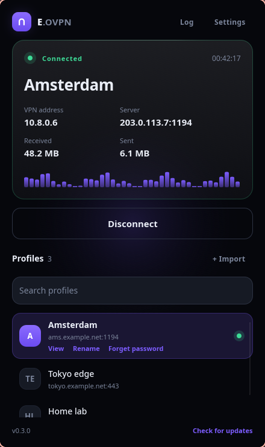
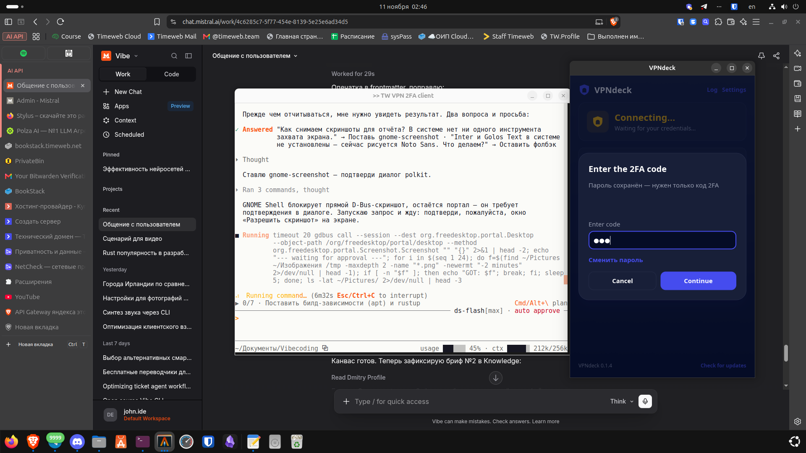
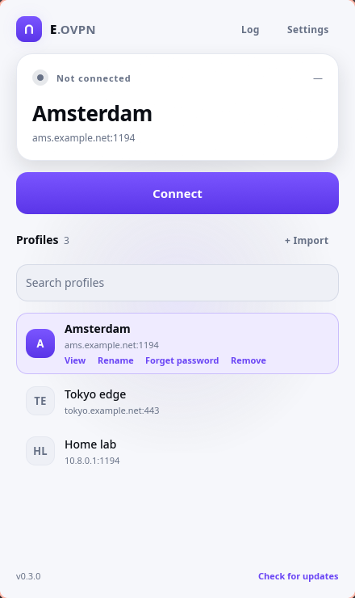

<p align="center">
  
</p>

<h1 align="center">Ether (ether-ovpn)</h1>

<p align="center">
  <b>English</b> · <a href="README.ru.md">Русский</a>
</p>

<p align="center">
  <a href="https://github.com/Etherhaus/ether-ovpn/releases/latest"></a>
  <a href="LICENSE"></a>
  
</p>

<p align="center">
  Ether (ether-ovpn) is a small desktop client for OpenVPN on Linux, written in Rust with
  <a href="https://slint.dev">Slint</a>.
  Import the <code>.ovpn</code> profiles from your OpenVPN server and connect with one click.
  Works with OpenVPN 2.4 or newer, including servers that ask for a 2FA code.
</p>



| Dark | Light |
|---|---|
|  |  |

## Features

- Import one or many `.ovpn` profiles at once (stored privately under `~/.config/ether`).
  Files that are already in the list are skipped, so re-importing a folder is safe
- Three more ways in: drop files onto the window, paste a profile from the clipboard, or
  download one from a link
- Rename profiles, search the list once it grows past a handful of servers
- Connect / disconnect with live status, VPN address, server and traffic counters, plus a
  download-speed graph for the current session
- Username/password and private-key password prompts. The username is remembered, and the
  password can be saved in your desktop keyring (GNOME Keyring / KWallet) for automatic sign-in
- Two-factor authentication: static challenge, CRV1 and crtext (see below)
- Reconnects on its own when a working tunnel drops (three attempts, five seconds apart)
- Desktop notifications when a connection starts, drops or fails
- English and Russian; dark, light or follow-the-system theme, and an optional coral window frame
- Live OpenVPN log with warnings and errors highlighted, a filter box, and a
  "Copy diagnostics" button that puts the version, OS, OpenVPN version and the last 50 lines
  on the clipboard for a support ticket
- System tray icon showing connection status, with one-click connect to the last profile.
  Closing the window keeps Ether running in the tray.
- Start with the session and connect on launch, both optional
- Checks GitHub for new releases and updates itself (tarball in place, .deb through apt, Flatpak through flatpak)
- Applies DNS pushed by the server when `update-systemd-resolved` or `update-resolv-conf` is installed
- Warns when an imported profile carries `up`, `down`, `plugin` or another directive that makes
  OpenVPN run a program as root

## Keyboard

| Keys | Action |
|---|---|
| `Ctrl+F` | Focus the profile search |
| `Ctrl+L` | Open the log |
| `Up` / `Down` | Move through the profile list |
| `Enter` | Connect, or disconnect while connected |
| `Esc` | Clear the search, or close a dialog |

## Two-factor authentication

Ether answers every challenge/response variant OpenVPN servers use:

| The server asks for | Ether sends |
|---|---|
| `--static-challenge` (SCRV1) | `SCRV1:<base64 password>:<base64 code>` |
| `--static-challenge` with FORMAT=1 | the code appended to the password |
| A CRV1 dynamic challenge | `CRV1::<state>::<code>` on the next attempt |
| crtext (OpenVPN 2.5+) | `cr-response <base64 code>` while authentication is pending |

It announces `IV_SSO=crtext` at startup, because servers that check it never send a crtext
challenge otherwise. When the password is already in the keyring, the dialog asks only for the
code. The wire format is OpenVPN's own
[management-notes.txt](https://github.com/OpenVPN/openvpn/blob/master/doc/management-notes.txt).

## Languages

The interface is available in English and Russian. The first start follows the desktop locale
(`LANG`), and Settings switches it at any time; the choice is stored in
`~/.config/ether/settings.json`. Every string lives in `src/i18n.rs`, so adding a language is
one more column in that table.

## Requirements

OpenVPN 2.4 or newer installed on the computer (tested with 2.6):

```bash
sudo apt install openvpn    # Debian, Ubuntu, Mint
sudo dnf install openvpn    # Fedora
```

The app runs as your user. `openvpn` is started through `pkexec`, so you'll get the normal
administrator prompt when connecting. Ether talks to it over OpenVPN's management interface
on a random localhost port protected by a one-time password.

## Install

OpenVPN must be installed on the system whichever package you use (see Requirements).
Download a package from the [latest release](https://github.com/Etherhaus/ether-ovpn/releases/latest).
The prebuilt packages are for x86_64.

**Debian, Ubuntu, Linux Mint** (`.deb`, needs Ubuntu 24.04+, Mint 22+ or Debian 13; pulls in `openvpn`):

```bash
sudo apt install ./ether-ovpn_*_amd64.deb
```

**Fedora, openSUSE** (`.rpm`, needs Fedora 40+ or openSUSE Tumbleweed for glibc 2.39):

```bash
sudo dnf install ./ether-ovpn-*.x86_64.rpm      # Fedora
sudo zypper install ./ether-ovpn-*.x86_64.rpm   # openSUSE
```

**Any distro with Flatpak** (`.flatpak`; the Freedesktop runtime is fetched from Flathub if needed):

```bash
flatpak install --user ./ether-ovpn-*-x86_64.flatpak
```

The Flatpak starts OpenVPN on the host through `flatpak-spawn --host`, so it is not meaningfully
sandboxed: it needs the same root access to run a VPN as the other packages.

**Tarball** (`.tar.gz`, needs glibc 2.39+). It installs to `~/.local/bin`, plus the app icon and an app-menu entry:

```bash
tar xzf ether-ovpn-*-x86_64-linux.tar.gz
cd ether-ovpn-*-x86_64-linux
packaging/install.sh
```

**From source:**

```bash
cargo build --release
packaging/install.sh
```

`SHA256SUMS` in each release lists the checksums of the files.

## Releasing

Bump the version in `Cargo.toml` and add a `<release>` entry to
`packaging/io.github.etherhaus.EtherOvpn.metainfo.xml`, then push a `v<version>` tag. The Release
workflow builds the tarball, .deb, .rpm, Flatpak and `SHA256SUMS` on Ubuntu 24.04 (so the binary
runs on glibc 2.39 and newer) and attaches them to the GitHub release for the tag, which it
leaves as a draft. Sign the files, upload the `.minisig` ones and publish the release by hand —
the in-app updater doesn't see drafts, so nobody is offered an unsigned update in the meantime.
To write the release notes yourself, create a draft release for the tag before pushing it.

`./packaging/build-packages.sh` builds the same files into `dist/` locally (needs `dpkg-deb`,
`rpmbuild`, `flatpak` and the `org.freedesktop.Platform//25.08` runtime).

### Signing releases

`SHA256SUMS` only proves a download matches the release page. To prove the release page is
ours, sign the files with [minisign](https://jedisct1.github.io/minisign/) and attach the
`.minisig` files to the release.

Create the key once and keep it out of the repository:

```bash
minisign -G                                   # creates ~/.minisign/minisign.key
```

Put the base64 line of `~/.minisign/minisign.pub` (the one after `untrusted comment:`) into
`PUBLIC_KEY` in `src/updater.rs` and rebuild. While `PUBLIC_KEY` is empty Ether skips the
check, so the key has to be in a release before that release's users are protected.

Once the Release workflow has attached the packages to the draft release, sign those files
rather than a local build, or the signatures won't match what was published, then publish it:

```bash
gh release download v0.3.1 -D dist
./packaging/sign-release.sh dist/*            # writes dist/*.minisig
gh release upload v0.3.1 dist/*.minisig
gh release edit v0.3.1 --draft=false --latest
```

`sign-release.sh` refuses to sign with a key that doesn't match `PUBLIC_KEY` and checks every
signature it writes. From then on Ether refuses to install an update whose signature is
missing, unreadable or made with another key, and says which of those it was.

## Getting started

Download the client configuration (`.ovpn` files) from your OpenVPN server, then click
**+ Import** in Ether and pick one or more files. On a fresh install the same button sits in
the middle of the window. Dropping the files onto the window, pasting a profile from the
clipboard and downloading one from a link all work too.

## Contributing

Bug reports and pull requests are welcome — [CONTRIBUTING.md](CONTRIBUTING.md) has the build
steps and a map of the code. A security problem goes to [SECURITY.md](SECURITY.md) instead of a
public issue.

## License

Ether is released under the [MIT License](LICENSE). It is built with [Slint](https://slint.dev),
used under the Slint Royalty-free Desktop, Mobile, and Web Applications License.

Ether started as a fork of [VPNdeck](https://github.com/thuutien/vpndeck) by Bryan Tran; his
copyright notice stays in `LICENSE` next to this project's.
