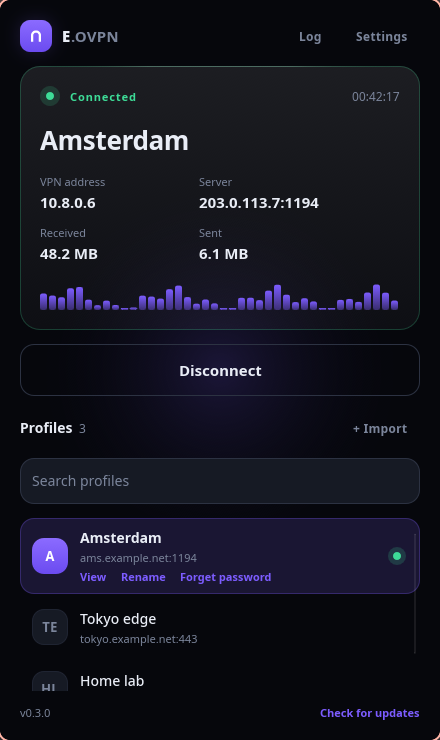
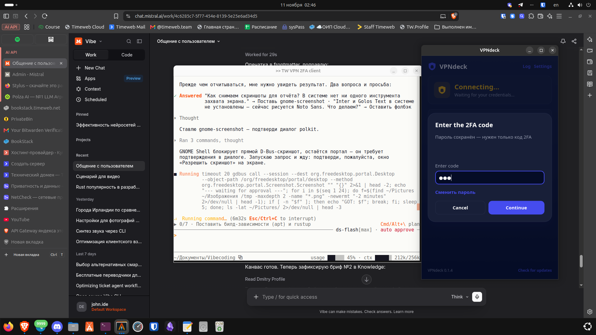
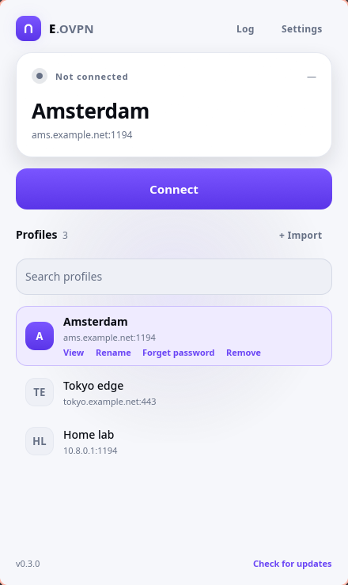

<p align="center">
  
</p>

<h1 align="center">Ether</h1>

<p align="center">
  <a href="README.md">English</a> · <b>Русский</b>
</p>

<p align="center">
  <a href="https://github.com/Etherhaus/ether-ovpn/releases/latest"></a>
  <a href="LICENSE"></a>
  
</p>

<p align="center">
  Небольшой настольный клиент OpenVPN для Linux на Rust и <a href="https://slint.dev">Slint</a>.
  Импортируйте <code>.ovpn</code>-профили со своего сервера OpenVPN и подключайтесь одним щелчком.
  Работает с OpenVPN 2.4 и новее, включая серверы, которые спрашивают код двухфакторной
  аутентификации.
</p>



| Тёмная тема | Светлая тема |
|---|---|
|  |  |

## Возможности

- Импорт одного или сразу нескольких `.ovpn`-профилей (хранятся приватно в `~/.config/ether`).
  Файлы, которые уже есть в списке, пропускаются, поэтому повторный импорт папки безопасен
- Ещё три способа добавить профиль: перетащить файлы на окно, вставить профиль из буфера обмена
  или скачать его по ссылке
- Переименование профилей и поиск по списку, когда серверов становится больше горстки
- Подключение и отключение с живым статусом, VPN-адресом, сервером и счётчиками трафика, плюс
  график скорости скачивания за текущий сеанс
- Запросы логина с паролем и пароля от приватного ключа. Логин запоминается, а пароль можно
  сохранить в связке ключей рабочего стола (GNOME Keyring / KWallet) для автоматического входа
- Двухфакторная аутентификация: static challenge, CRV1 и crtext (см. ниже)
- Переподключение, когда рабочий туннель обрывается (три попытки с интервалом в пять секунд)
- Уведомления на рабочем столе, когда соединение устанавливается, обрывается или падает
- Английский и русский; тёмная, светлая тема или тема системы, а коралловое обрамление окна
  можно отключить
- Живой лог OpenVPN с подсветкой предупреждений и ошибок, поле фильтра и кнопка
  «Скопировать диагностику», которая кладёт в буфер обмена версию, ОС, версию OpenVPN и
  последние 50 строк для обращения в поддержку
- Значок в системном лотке со статусом соединения и подключением к последнему профилю одним
  щелчком. Закрытие окна оставляет Ether работать в лотке
- Запуск вместе с сеансом и подключение при запуске — оба параметра необязательны
- Проверяет новые релизы на GitHub и обновляется сам (тарбол на месте, .deb через apt, Flatpak
  через flatpak)
- Применяет DNS, который присылает сервер, если установлен `update-systemd-resolved` или
  `update-resolv-conf`
- Предупреждает, если импортированный профиль содержит `up`, `down`, `plugin` или другую
  директиву, из-за которой OpenVPN запускает программу от root

## Клавиатура

| Клавиши | Действие |
|---|---|
| `Ctrl+F` | Перейти к поиску по профилям |
| `Ctrl+L` | Открыть лог |
| `Up` / `Down` | Двигаться по списку профилей |
| `Enter` | Подключиться, а при активном соединении — отключиться |
| `Esc` | Очистить поиск или закрыть диалог |

## Двухфакторная аутентификация

Ether отвечает на все варианты challenge/response, которые используют серверы OpenVPN:

| Сервер просит | Ether отправляет |
|---|---|
| `--static-challenge` (SCRV1) | `SCRV1:<base64 password>:<base64 code>` |
| `--static-challenge` с FORMAT=1 | код, дописанный к паролю |
| Динамический challenge CRV1 | `CRV1::<state>::<code>` при следующей попытке |
| crtext (OpenVPN 2.5+) | `cr-response <base64 code>`, пока аутентификация в процессе |

При старте Ether объявляет `IV_SSO=crtext`, иначе серверы, которые это проверяют, никогда не
пришлют crtext-challenge. Если пароль уже в связке ключей, диалог спрашивает только код. Формат
обмена — собственный
[management-notes.txt](https://github.com/OpenVPN/openvpn/blob/master/doc/management-notes.txt)
OpenVPN.

## Языки

Интерфейс доступен на английском и русском. При первом запуске язык берётся из локали рабочего
стола (`LANG`), а в настройках его можно сменить в любой момент; выбор хранится в
`~/.config/ether/settings.json`. Все строки лежат в `src/i18n.rs`, поэтому новый язык — это ещё
одна колонка в той таблице.

## Требования

OpenVPN 2.4 или новее, установленный в системе (проверено на 2.6):

```bash
sudo apt install openvpn    # Debian, Ubuntu, Mint
sudo dnf install openvpn    # Fedora
```

Приложение работает от вашего пользователя. `openvpn` запускается через `pkexec`, поэтому при
подключении появится обычный запрос прав администратора. С ним Ether общается через
management-интерфейс OpenVPN на случайном порту localhost, защищённом одноразовым паролем.

## Установка

OpenVPN должен быть установлен в системе независимо от того, какой пакет вы выберете (см.
«Требования»). Скачайте пакет из
[последнего релиза](https://github.com/Etherhaus/ether-ovpn/releases/latest). Готовые пакеты
собраны для x86_64.

**Debian, Ubuntu, Linux Mint** (`.deb`, нужен Ubuntu 24.04+, Mint 22+ или Debian 13; подтягивает `openvpn`):

```bash
sudo apt install ./ether-ovpn_*_amd64.deb
```

**Fedora, openSUSE** (`.rpm`, нужен Fedora 40+ или openSUSE Tumbleweed ради glibc 2.39):

```bash
sudo dnf install ./ether-ovpn-*.x86_64.rpm      # Fedora
sudo zypper install ./ether-ovpn-*.x86_64.rpm   # openSUSE
```

**Любой дистрибутив с Flatpak** (`.flatpak`; рантайм Freedesktop при необходимости скачается с Flathub):

```bash
flatpak install --user ./ether-ovpn-*-x86_64.flatpak
```

Flatpak запускает OpenVPN на хосте через `flatpak-spawn --host`, так что изоляции здесь по сути
нет: для работы VPN ему нужен тот же root, что и остальным пакетам.

**Тарбол** (`.tar.gz`, нужен glibc 2.39+). Ставится в `~/.local/bin`, плюс иконка и пункт в меню
приложений:

```bash
tar xzf ether-ovpn-*-x86_64-linux.tar.gz
cd ether-ovpn-*-x86_64-linux
packaging/install.sh
```

**Из исходников:**

```bash
cargo build --release
packaging/install.sh
```

`SHA256SUMS` в каждом релизе содержит контрольные суммы файлов.

## Выпуск релиза

Поднимите версию в `Cargo.toml` и добавьте запись `<release>` в
`packaging/io.github.etherhaus.EtherOvpn.metainfo.xml`, затем запушьте тег `v<версия>`. Workflow
Release соберёт тарбол, .deb, .rpm, Flatpak и `SHA256SUMS` на Ubuntu 24.04 (чтобы бинарник
работал на glibc 2.39 и новее), приложит их к релизу на GitHub для этого тега и опубликует его —
именно туда смотрит встроенный обновлятор. Если хотите написать заметки к релизу сами, создайте
черновик релиза для тега до пуша.

`./packaging/build-packages.sh` собирает те же файлы в `dist/` локально (нужны `dpkg-deb`,
`rpmbuild`, `flatpak` и рантайм `org.freedesktop.Platform//25.08`).

### Подпись релизов

`SHA256SUMS` доказывает только то, что скачанный файл совпадает со страницей релиза. Чтобы
доказать, что страница релиза наша, подпишите файлы через
[minisign](https://jedisct1.github.io/minisign/) и приложите `.minisig` к релизу.

Ключ создаётся один раз и хранится вне репозитория:

```bash
minisign -G                                   # создаёт ~/.minisign/minisign.key
```

Вставьте base64-строку из `~/.minisign/minisign.pub` (ту, что идёт после `untrusted comment:`)
в `PUBLIC_KEY` в `src/updater.rs` и пересоберите. Пока `PUBLIC_KEY` пуст, Ether проверку
пропускает, поэтому ключ должен попасть в релиз раньше, чем его пользователи окажутся под
защитой.

Когда workflow Release приложил пакеты к релизу, подписывайте именно их, а не локальную сборку,
иначе подписи не совпадут с опубликованными файлами:

```bash
gh release download v0.3.1 -D dist
./packaging/sign-release.sh dist/*            # пишет dist/*.minisig
gh release upload v0.3.1 dist/*.minisig
```

`sign-release.sh` отказывается подписывать ключом, который не совпадает с `PUBLIC_KEY`, и
проверяет каждую записанную подпись. С этого момента Ether отказывается ставить обновление,
подпись которого отсутствует, не читается или сделана другим ключом, и говорит, что именно
случилось.

## С чего начать

Скачайте конфигурацию клиента (`.ovpn`-файлы) со своего сервера OpenVPN, затем нажмите
**+ Импорт** в Ether и выберите один или несколько файлов. На свежей установке та же кнопка
находится в середине окна. Перетаскивание файлов на окно, вставка профиля из буфера обмена и
скачивание по ссылке тоже работают.

## Участие

Баг-репорты и pull request'ы приветствуются — в [CONTRIBUTING.md](CONTRIBUTING.md) есть шаги
сборки и карта кода. Об уязвимости пишите по [SECURITY.md](SECURITY.md), а не в публичный issue.

## Лицензия

Ether распространяется по [лицензии MIT](LICENSE). Он собран на [Slint](https://slint.dev),
используемом по Slint Royalty-free Desktop, Mobile, and Web Applications License.

Ether начинался как форк [VPNdeck](https://github.com/thuutien/vpndeck) за авторством Bryan Tran;
его уведомление об авторских правах остаётся в `LICENSE` рядом с уведомлением этого проекта.
